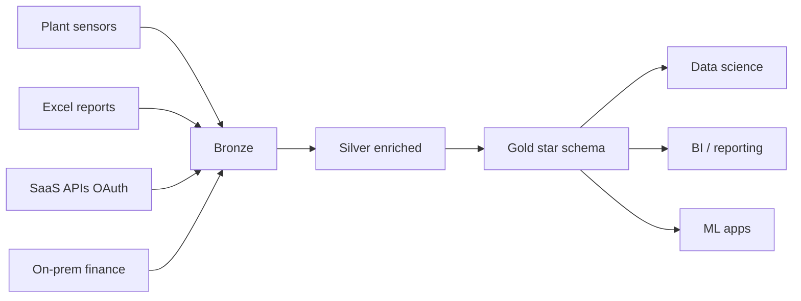
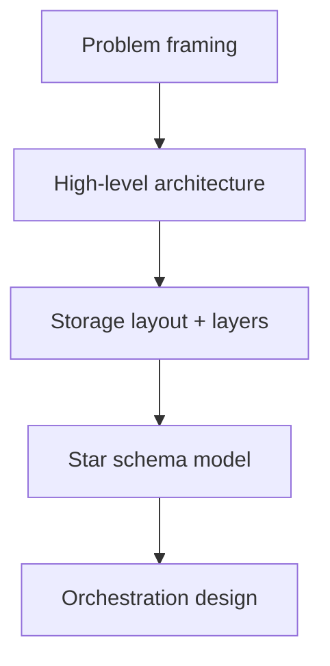

# Octan Digital Transformation Data Platform

**Delivered by:** [Zynx Technologies Ltd](https://www.zynxtechnologies.com/)  
**Portfolio host (pre-fork):** `anoopdk/Octan-CaseStudy`  
**Domain client (sanitised):** Zynx x Energy & Industrial Client  
**Engagement type:** Solution Design / Case Delivery  
**Portfolio version:** `1.0.0-portfolio`

> Inspection note: Client identity is domain-aliased for public portfolio use. This repository is structured for authenticity review of delivery artefacts, architecture, and engagement scope.

## Project overview

The Energy & Industrial Client (Octan scenario) needed a scalable data platform that could ingest IoT plant sensors, Excel project reports, OAuth-protected SaaS APIs, and sensitive on-prem financial data, while enabling autonomous analytics under strong access control.

### Solution delivered

Zynx designed a medallion lakehouse target architecture with bronze/silver/gold refinement, star-schema curated models, orchestration diagrams, and operational ownership guidance suitable for the client's data engineering and infrastructure teams.

## Engagement levels

| # | Level |
| --- | --- |
| 1 | Discovery & Problem Framing |
| 2 | Target Architecture Design |
| 3 | Data Modelling (Star Schema) |
| 4 | Orchestration Blueprint |

| Field | Value |
| --- | --- |
| Engagement posture | Delivery portfolio artefact prepared for audit / inspection |
| Confidentiality | Domain alias only; no real client legal name in public docs |
| Primary artefacts | Code/notebooks/docs already in-repo + Zynx standard pack under `docs/` and `decks/` |

## Architecture

### Implementation flow

## Technology stack

`Medallion architecture`, `Lakehouse design`, `Star schema`, `Streaming + batch`, `RBAC / sensitivity controls`

## Repository map

| Path | Purpose |
| --- | --- |
| `README.md` | Project overview + engagement levels |
| `docs/` | Problem, solution, architecture, implementation, runbook, audit factsheet |
| `decks/` | 3-slide delivery overview (Markdown + HTML) |
| `src/` / project subtree | Implementation assets (or placeholders where design-led) |
| `tests/` | Tests or placeholders |
| `scripts/` | Operational / helper scripts |
| `configs/` | Non-secret configuration templates |
| `.env.example` | Environment variable placeholders |

### Key existing delivery paths

- `case-study/exercise.md`
- `case-study/diagrams/`

## How to inspect this repository

1. Read this README (overview + engagement).
2. Open `docs/audit/PROJECT-FACTSHEET.md`.
3. Review architecture in `docs/03-architecture.md`.
4. Walk implementation evidence listed in the factsheet.
5. Open `decks/overview.html` for the 3-slide executive summary.

## Related Zynx context

Zynx Technologies Ltd provides IT consulting across cloud, data analytics, and digital delivery. This repository is part of the public delivery portfolio hosted on `anoopdk` prior to organisation-level fork.

## License

See `LICENSE`.
